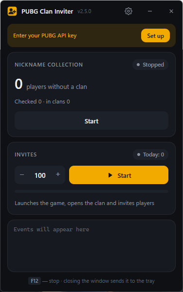
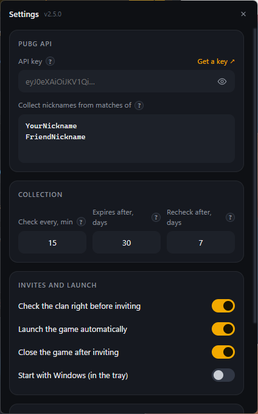

# PUBG Clan Inviter

**English** · [Русский](README.ru.md)

A Windows app that grows your PUBG: BATTLEGROUNDS clan on autopilot. Set your API key and a few nicknames once, then it is two buttons.

<p align="center">
  
  &nbsp;
  
</p>

- **Nickname collection: Start / Stop.** The app watches the recent matches of players you choose (you, your friends) and takes every real player from them. Each one is checked right away through the official PUBG API, and only players **without a clan** are kept. Nicknames the API can no longer find are removed, and so are players who have not been seen in matches for N days (30 by default).
- **Invites: Start.** The app launches PUBG, opens **Clan → Invites** by itself, invites the number of players you set (the most recently active first) and closes the game.

The app finds the game's buttons and fields by their **icons on screen**, so it works with any resolution, monitor, window mode and **any game language**. Nothing to record or calibrate. It lives in the system tray.

## Install

1. Download `PUBG_Inviter_Setup_x.y.z.exe` from [Releases](../../releases) and run it. No administrator rights needed.
2. Get a free API key at [developer.pubg.com](https://developer.pubg.com/).
3. Open ⚙ Settings in the app, paste the key and the nicknames to collect from, and save. Hover the **?** icons for hints.
4. Press **Start** under *Nickname collection*. When the list has grown, press **Start** under *Invites*.

While inviting, keep the game window in front: if it is not active, the app waits. **F12** stops the invites.

## How invites work

- Every nickname is used **once**. The app searches for it in the game and, if the player exists, presses *Invite* once. If the player is not found, the nickname is marked as used as well.
- Used nicknames never come back, even if the player shows up in matches again.
- The game's reply ("invited", "already sent", ...) is not read, so the app behaves the same in every game language.
- If the lobby did not load completely, the app restarts it from the system menu. On a server error it presses *Reconnect*.

## Requirements

- Windows 10 or 11.
- PUBG: BATTLEGROUNDS on Steam, any game language.

## Interface language

The app uses the Windows display language if a translation exists, English otherwise. You can change it in Settings. Available: English, Русский.

Adding a language is easy: copy `ui/lang/en.json` to `ui/lang/<code>.json` (e.g. `de.json`), translate the values and set `_name`. The app lists it automatically. Pull requests with translations are welcome.

Settings, the database and the log are stored in `%APPDATA%\PUBG_Inviter` (`config.json`, `data.db`, `log.txt`).

## About the anti-cheat

The app never reads or changes the game's memory or files. It only takes screenshots and presses the mouse and keyboard through the standard Windows mechanism (`SendInput`), like ordinary clickers do. Automating input may still be against the game's rules. **Use at your own risk.**

## Build from source

Requires Python 3.13 and [Inno Setup 6](https://jrsoftware.org/isdl.php).

```bat
build.bat
```

Output: `dist\PUBG_Inviter_Setup_<version>.exe`. The version is set in `app.py` (`APP_VERSION`).

| File | Contents |
|---|---|
| `app.py` | windows, tray, invite run |
| `game.py` | finding game UI elements and inviting |
| `vision.py` | icon search on screen |
| `ocr.py` | Windows text recognition (used only as a shortcut) |
| `collector.py` | PUBG API, SQLite database, collection and clan checks |
| `i18n.py`, `ui/lang/` | interface languages |
| `winput.py` | mouse and keyboard input |
| `ui/` | interface (HTML/CSS) |
